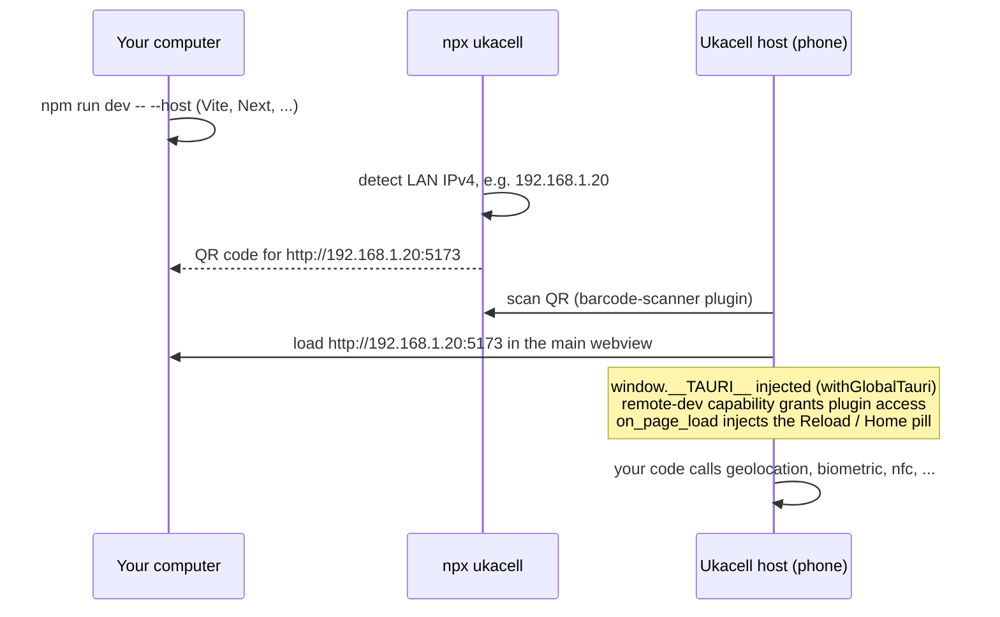

<p align="center">
  
</p>

<h1 align="center">Ukacell</h1>

<p align="center">
  The mobile dev companion for <strong>Tauri v2</strong>.<br />
  Scan a QR code and your frontend runs on a real phone, with 20 native plugins ready to call. No native rebuild needed.
</p>

<p align="center">
  <a href="LICENSE"></a>
  
  
  
</p>

---

Building a Tauri mobile app normally means a Rust + Gradle/Xcode build every
time you want to see a change on a device. Ukacell flips that around: install
one prebuilt **host app** that already contains the official Tauri plugins,
point it at your dev server, and iterate on your frontend with hot reload
while calling the camera, GPS, biometrics, NFC and the rest for real.

| Part | Path | What it is |
| --- | --- | --- |
| **Host app** | [`apps/host`](apps/host) | Tauri v2 Android/iOS app with 20 plugins pre-bundled, a QR launcher and an injected dev menu. |
| **CLI** | [`packages/cli`](packages/cli) | `npx ukacell`: finds your LAN IP and prints a QR code for your dev server. |
| **CI** | [`.github/workflows`](.github/workflows) | Builds a signed universal APK and publishes it to GitHub Releases on every `v*` tag. |
| **Playground** | [`examples/playground`](examples/playground) | A one-page app with a button per plugin. `npm run playground` serves it and prints the QR code. |
| **Brand** | [`docs/brand`](docs/brand) | Logo, app icon, animated logo and wordmark lockups (SVG). |

> Ukacell is a community project. It is not affiliated with or endorsed by
> the Tauri Programme.

## Contents

- [How it works](#how-it-works)
- [Quick start](#quick-start)
- [Installing the host app](#installing-the-host-app)
- [Using the CLI](#using-the-cli)
- [Calling native APIs from your app](#calling-native-apis-from-your-app)
- [Bundled plugins](#bundled-plugins)
- [Security model](#security-model)
- [Limitations](#limitations)
- [Building the host from source](#building-the-host-from-source)
- [Releasing](#releasing)
- [Contributing](#contributing)
- [Brand](#brand)
- [License](#license)

## How it works



```
ukacell/
├── apps/host/                      Tauri v2 mobile host
│   ├── src/                        launcher UI: plain HTML/CSS/JS, no bundler
│   ├── scripts/patch-android.mjs   manifest permissions, cleartext, signing
│   └── src-tauri/
│       ├── capabilities/
│       │   ├── default.json        launcher permissions
│       │   └── remote-dev.json     permissions for LAN dev servers
│       ├── src/lib.rs              plugins, on_page_load hook, deep links
│       ├── src/floating_menu.js    injected Reload / Home pill
│       ├── Info.ios.plist          iOS usage descriptions + ATS
│       └── tauri.conf.json
├── packages/cli/                   the `ukacell` npm package
└── .github/workflows/
    └── release-android.yml         tag → universal APK → GitHub Release
```

Three Tauri v2 features carry the whole design:

1. **`app.withGlobalTauri: true`** makes every page in the main webview,
   including your remote dev server, receive `window.__TAURI__` plus each
   plugin's namespace.
2. **Remote capabilities.** `capabilities/remote-dev.json` uses
   `remote.urls` to grant plugin permissions to `http://localhost:*`,
   `http://127.0.0.1:*` and every private IPv4 range (`192.168.0.0/16`,
   `10.0.0.0/8`, `172.16.0.0/12`), and nothing else. The IP ranges are written
   as URLPattern regexp groups such as `http://(192\.168\.\d{1,3}\.\d{1,3}):*/*`,
   because a wildcard inside an IP literal (`192.168.*.*`) never matches.
   Unit tests in `src/lib.rs` check the patterns.
3. **`Builder::on_page_load`.** Once a page that is not the launcher
   finishes loading, Rust injects a small script that draws a
   semi-transparent, draggable pill with **Reload** and **Home /
   Disconnect**.

## Quick start

1. **Install the host app** on your Android phone from the
   [latest release](https://github.com/urukaa/ukacell/releases/latest)
   (see below).
2. **Start your frontend and the CLI** in your Tauri project:

   ```bash
   npx ukacell --run          # runs `npm run dev -- --host`, then prints a QR code
   # or, if your dev server is already running on port 5173:
   npx ukacell
   ```

3. **Scan** the QR code with Ukacell. Your app opens and every bundled
   plugin is available. Use the floating pill to reload or to go back to
   the launcher.

Phone and computer must be on the same Wi-Fi network.

No project at hand? From a clone of this repository, `npm run playground`
starts [`examples/playground`](examples/playground) (a page with a test
button for every plugin) and prints its QR code.

## Installing the host app

### Android (APK)

1. Open [Releases](https://github.com/urukaa/ukacell/releases) on your phone
   and download `ukacell-<version>-universal.apk`. The universal APK runs on
   arm64, armv7, x86 and x86_64, Android 7.0 (API 24) and newer.
2. Open the file. If Android asks, allow your browser or file manager to
   *Install unknown apps*.
3. Launch **Ukacell** and grant camera access when you first scan.

To verify the download, compare it with the `.sha256` file attached to the
release: `sha256sum -c ukacell-<version>-universal.apk.sha256`.

With USB debugging you can also run
`adb install -r ukacell-<version>-universal.apk`.

### iOS

Apple does not allow sideloading, so there is no prebuilt iOS download.
Build and run it from a Mac with your own Apple developer account:
`npm run host:ios:dev` (see [Building the host from source](#building-the-host-from-source)).

## Using the CLI

```bash
npx ukacell [port] [options] [-- <dev script args>]
```

| Option | Description |
| --- | --- |
| `[port]`, `-p, --port <port>` | Dev server port. Default `5173`. `npx ukacell 3000` and `npx ukacell --port 3000` are equivalent. |
| `-r, --run` | Runs `npm run dev -- --host` in a child process, waits until the port answers, then prints the QR code. Ctrl+C stops both. |
| `--host <ip>` | Put this address in the QR code instead of the detected one. |
| `-- <args>` | With `--run`, extra arguments for your dev script. |
| `-v, --version` / `-h, --help` | Version / usage. |

The CLI picks the most likely Wi-Fi/LAN address: private ranges first,
physical adapters before virtual ones (WSL, Hyper-V, Docker, VPN), and lists
alternatives under the QR code. Its only dependencies are
[`qrcode-terminal`](https://www.npmjs.com/package/qrcode-terminal) and
[`picocolors`](https://www.npmjs.com/package/picocolors).

**Your dev server must listen on the network**, not only on localhost:

| Tool | Command |
| --- | --- |
| Vite (Svelte, Vue, React, Solid, ...) | `vite --host` (what `--run` adds) |
| Next.js | `next dev -H 0.0.0.0` |
| Nuxt | `nuxi dev --host` |
| Angular | `ng serve --host 0.0.0.0` |

You can also skip the CLI and open the launcher's **Enter URL manually**
field, or use a deep link: `ukacell://open?url=http%3A%2F%2F192.168.1.20%3A5173`.

## Calling native APIs from your app

Nothing extra is required in your project. Pick either style:

**1. The global object** (always injected by the host):

```js
const { geolocation, haptics, notification } = window.__TAURI__;

const position = await geolocation.getCurrentPosition();
await haptics.vibrate(200);
await notification.sendNotification({ title: "Hello from Ukacell", body: `${position.coords.latitude}` });
```

**2. The official npm packages** (the same code you ship in your real app):

```bash
npm install @tauri-apps/api @tauri-apps/plugin-barcode-scanner @tauri-apps/plugin-biometric
```

```js
import { scan, Format } from "@tauri-apps/plugin-barcode-scanner";
import { authenticate } from "@tauri-apps/plugin-biometric";

await authenticate("Confirm it's you");
const result = await scan({ formats: [Format.QRCode] });
```

The torch plugin ships no JavaScript package, so call it through `invoke`:

```js
import { invoke } from "@tauri-apps/api/core"; // or window.__TAURI__.core.invoke

await invoke("plugin:torch|toggle", { payload: { value: true } });  // on
await invoke("plugin:torch|toggle", { payload: { value: false } }); // off
const { value: isOn } = await invoke("plugin:torch|check");
```

Use major version 2 of the `@tauri-apps/plugin-*` packages so they match the
crates bundled in the host (table below).

To keep the same code working in a plain browser, guard native calls with
`if ("__TAURI_INTERNALS__" in window) { ... }`.

## Bundled plugins

All official plugins come from
[tauri-apps/plugins-workspace](https://github.com/tauri-apps/plugins-workspace).
The **Permissions** column lists what `remote-dev.json` grants to dev servers.

| # | Plugin | Crate (version) | JS API | Platforms | Permissions for dev servers |
| --- | --- | --- | --- | --- | --- |
| 1 | Barcode Scanner | `tauri-plugin-barcode-scanner` 2.5.3 | `barcodeScanner` | Android, iOS | `barcode-scanner:default` (scan, cancel, check/request permissions, open app settings, vibrate), `barcode-scanner:allow-scan` |
| 2 | Biometric | `tauri-plugin-biometric` 2.5.0 | `biometric` | Android, iOS | `biometric:default` (authenticate, status), `biometric:allow-authenticate` |
| 3 | Geolocation | `tauri-plugin-geolocation` 2.5.0 | `geolocation` | Android, iOS | `geolocation:allow-check-permissions`, `allow-request-permissions`, `allow-get-current-position`, `allow-watch-position`, `allow-clear-watch` (the plugin has no `default` set) |
| 4 | Haptics | `tauri-plugin-haptics` 2.4.2 | `haptics` | Android, iOS | `haptics:allow-vibrate`, `allow-impact-feedback`, `allow-notification-feedback`, `allow-selection-feedback` (no `default` set) |
| 5 | NFC | `tauri-plugin-nfc` 2.4.2 | `nfc` | Android, iOS | `nfc:default` (is-available, scan), `nfc:allow-scan`. Writing tags is not granted. |
| 6 | Torch ⚠️ | `tauri-plugin-torch` 0.1.0 | `invoke("plugin:torch\|toggle")` | Android, iOS | `torch:default` (toggle, check), `torch:allow-toggle` |
| 7 | File System | `tauri-plugin-fs` 2.7.1 | `fs` | All | `fs:default` (read app dirs, create them), `fs:allow-appdata-read-recursive`, `fs:allow-appdata-write-recursive` |
| 8 | Store | `tauri-plugin-store` 2.5.1 | `store` | All | `store:default` (all operations) |
| 9 | SQL (SQLite) | `tauri-plugin-sql` 2.6.0, feature `sqlite` | `sql` | All | `sql:default` (load, select, close), `sql:allow-execute` |
| 10 | Stronghold ¹ | `tauri-plugin-stronghold` 2.4.0 | `stronghold` | All | `stronghold:default` (all non-destructive operations), from `capabilities/stronghold/` |
| 11 | Notification | `tauri-plugin-notification` 2.8.1 | `notification` | All | `notification:default` (all operations) |
| 12 | Dialog | `tauri-plugin-dialog` 2.8.4 | `dialog` | All | `dialog:default` (message, open, save), `dialog:allow-ask`, `dialog:allow-confirm` |
| 13 | Clipboard | `tauri-plugin-clipboard-manager` 2.5.0 | `clipboardManager` | All | `clipboard-manager:default` (empty by design), `allow-read-text`, `allow-write-text` |
| 14 | Opener | `tauri-plugin-opener` 2.7.3 | `opener` | All | `opener:default` (http(s), mailto and tel URLs; reveal item in dir) |
| 15 | Deep Link | `tauri-plugin-deep-link` 2.6.3 | `deepLink` | All | `deep-link:default` (get current link) |
| 16 | HTTP | `tauri-plugin-http` 2.9.0 | `http` | All | `http:default` scoped to `http://*:*` and `https://*:*` |
| 17 | WebSocket | `tauri-plugin-websocket` 2.5.0 | `websocket` | All | `websocket:default` (connect, send) |
| 18 | Upload | `tauri-plugin-upload` 2.5.0 | `upload` | All | `upload:default` (upload, download) |
| 19 | OS | `tauri-plugin-os` 2.4.0 | `os` | All | `os:default` (everything except hostname) |
| 20 | Log | `tauri-plugin-log` 2.10.2 | `log` | All | `log:default` |

Plugins 1 to 6 are registered only on mobile (`#[cfg(mobile)]` in
`lib.rs`). On a desktop `tauri dev` window they are compiled but not
initialized, so calls return a "plugin not found" error. The host is built
on `tauri` 2.12.7, `tauri-build` 2.7.6 and `@tauri-apps/cli` 2.12.6.

¹ **Stronghold is behind the `stronghold` Cargo feature.** It depends on
libsodium, whose build script can only cross-compile for Android from Linux
or macOS (it runs `./configure`). Release APKs from CI are built with
`--features stronghold`; local Android builds on Windows leave it out, and the
launcher's plugin list then marks it *Not in this build*. `build.rs` only loads
`capabilities/stronghold/` when the feature is on.

⚠️ **Torch is a community plugin** ([sosweetham/tauri-plugin-torch](https://github.com/sosweetham/tauri-plugin-torch)),
not part of the official workspace. The official workspace has no torch
plugin. Its source was reviewed before inclusion (it only calls
`CameraManager.setTorchMode` / `AVCaptureDevice.torchMode`), but it has
fewer users and less review than the official plugins.

## Security model

Ukacell is a **development tool**. Read this before installing it on a phone
you care about.

- **Who gets native access.** Only pages whose origin matches
  `remote-dev.json` (`http://` on `localhost`, `127.0.0.1`, `192.168.x.x`,
  `10.x.x.x` or `172.16-31.x.x`) can call plugins. Any other origin,
  including `https://` tunnels and public IPs, still loads but every IPC call is
  rejected. The launcher warns before opening such URLs.
- **What "trusted" means.** Any device on your LAN that serves a page in
  those ranges, and that you open in Ukacell, gets the permissions in the
  table above: location, camera, biometric prompts, clipboard text, app-data
  files, the SQLite databases and unrestricted HTTP. Only open servers you
  run yourself, and avoid using Ukacell on untrusted public Wi-Fi.
- **Shared sandbox.** Every app you open shares the host's app-data
  directory, store files, SQLite databases and Stronghold vaults. Do not use
  real credentials or production data.
- **Cleartext HTTP** is enabled in the APK because dev servers are plain
  `http://`. Never ship Ukacell's configuration in a production app.
- **The launcher** (`default.json`) can only use the barcode scanner and deep
  links.

Found a vulnerability? Please report it privately through
[GitHub security advisories](https://github.com/urukaa/ukacell/security/advisories/new)
instead of opening a public issue.

## Limitations

- **Frontend only.** Your app's own Rust code (`#[tauri::command]`s, custom
  plugins, `setup` hooks) is not part of the prebuilt host, so it does not
  run in Ukacell. Test those with `tauri android dev` /
  `tauri ios dev`.
- **Only the bundled plugins.** A plugin missing from the table needs a new
  host build (see [Contributing](#contributing)).
- **Shared configuration.** Your `tauri.conf.json` and `capabilities/` are
  not read. The host's configuration applies.
- **Navigation.** Ukacell runs your app in a single webview, so APIs that
  create windows or webviews are not supported.

## Building the host from source

Prerequisites: Node.js 18.18+, Rust 1.90+, and for Android: JDK 17+, Android
SDK and NDK 27 with `ANDROID_HOME` / `NDK_HOME` set. For iOS: macOS with
Xcode. The [Tauri prerequisites guide](https://v2.tauri.app/start/prerequisites/)
covers the setup.

```bash
git clone https://github.com/urukaa/ukacell.git
cd ukacell
npm install

# Android
rustup target add aarch64-linux-android armv7-linux-androideabi i686-linux-android x86_64-linux-android
npm run host:android:init       # tauri android init + icons + patch-android.mjs
npm run host:android:dev        # run on a connected device or emulator
npm run host:android:build      # universal APK in apps/host/src-tauri/gen/android/app/build/outputs/apk/
# Linux/macOS only: include Stronghold like the release build does
npm run tauri --workspace apps/host -- android build --apk --features stronghold

# iOS (macOS)
npm run host:ios:init
npm run host:ios:dev

# Desktop window, handy for working on the launcher UI
npm run host:dev
```

[`apps/host/README.md`](apps/host/README.md) explains the Android manifest
changes, release signing and the iOS `Info.plist` keys in detail.

## Releasing

Push a semantic-version tag and
[`release-android.yml`](.github/workflows/release-android.yml) does the rest:

```bash
git tag v0.1.0
git push origin v0.1.0
```

The workflow installs Rust (all four Android targets), Java 21, the Android
SDK and NDK 27. It stamps the tag's version into `tauri.conf.json` and runs
`tauri android init` if `src-tauri/gen/android` is not committed. Then it
generates icons, patches the manifest, runs `tauri android build --apk` and
publishes `ukacell-<version>-universal.apk` plus its SHA-256 checksum to a
GitHub Release. Tags with a suffix (`v0.2.0-beta.1`) are marked as
pre-releases. You can also start it by hand from the Actions tab; that
uploads the APK as a workflow artifact only.

**Signing.** Add these repository secrets so every release is signed with
the same key. Android only installs an update over an existing install when
the signatures match.

| Secret | Value |
| --- | --- |
| `ANDROID_KEYSTORE_BASE64` | `base64 -w0 ukacell-release.jks` |
| `ANDROID_KEYSTORE_PASSWORD` | the keystore (and key) password |
| `ANDROID_KEY_ALIAS` | the key alias, e.g. `ukacell` |

Without them, the workflow signs with a throwaway key and prints a warning.
The APK installs fine, but users must uninstall the previous version first.

To publish the CLI:

```bash
cd packages/cli
npm publish --access public
```

## Contributing

Contributions are welcome: bug reports, plugin additions, docs and UI
polish.

1. **Discuss first** for anything bigger than a bug fix: open an issue
   describing the problem and the proposed change.
2. **Fork and branch** from `main` (`feat/nfc-write`, `fix/cli-wsl-ip`).
3. **Set up** with `npm install`, then work on the part you are changing:
   - CLI: `node packages/cli/bin/cli.js --help` and `npm run cli:check`.
   - Launcher UI: `npm run host:dev` opens it in a desktop window.
   - Native side: `npm run host:android:dev` on a device.
4. **Keep it consistent.** The host frontend stays dependency-free (no
   bundler), the CLI keeps its two dependencies, Rust code passes
   `cargo fmt` and `cargo clippy` in `apps/host/src-tauri`.
5. **Open a pull request** that explains *what* and *why*, links the issue,
   and says which devices you tested on.

### Adding a plugin

A plugin is only useful if all five of these are updated together:

1. `apps/host/src-tauri/Cargo.toml`: add the crate (pin the latest version).
2. `apps/host/src-tauri/src/lib.rs`: register it, behind `#[cfg(mobile)]`
   if it has no desktop implementation.
3. `apps/host/src-tauri/capabilities/remote-dev.json`: add its permissions.
   Check `permissions/default.toml` in the crate first; some plugins
   (geolocation, haptics) have no `default` set and the build fails if you
   reference one.
4. `apps/host/scripts/patch-android.mjs` and
   `apps/host/src-tauri/Info.ios.plist`: any new Android permission or iOS
   usage description.
5. The `PLUGINS` list in `apps/host/src/main.js` and the
   [table above](#bundled-plugins).

### Reporting bugs

Include the Ukacell version (shown at the bottom of the launcher), phone
model and OS version, the output of `npx ukacell`, and for native errors
the log (`adb logcat | grep -i tauri` on Android).

## Brand

The mark is a laptop screen and a phone whose overlap is knocked out: your app,
on both. In motion it tells the rest of the story: the phone divides from the
laptop like a cell, then locks into place.

| Asset | Use |
| --- | --- |
| [`ukacell-mark.svg`](docs/brand/ukacell-mark.svg) / [`-white`](docs/brand/ukacell-mark-white.svg) | The mark alone, for light / dark backgrounds |
| [`ukacell-icon.svg`](docs/brand/ukacell-icon.svg) | App icon tile |
| [`ukacell-animated.svg`](docs/brand/ukacell-animated.svg) | Animated "divide" logo, also the launcher's opening animation |
| [`ukacell-lockup-light.svg`](docs/brand/ukacell-lockup-light.svg) / [`-dark`](docs/brand/ukacell-lockup-dark.svg) | Mark + `ukacell` wordmark for light / dark backgrounds |

Colours: warm neutrals with one accent. The laptop is ink (`#1C1B19` on light,
`#EEEBE6` on dark), the phone is the only coloured part (sky `#38BDF8`, or
`#0EA5E9` on light backgrounds). The icon background is `#171615`. The
launcher UI uses the same palette in a light and a dark theme. The wordmark is
always lowercase, bold and tightly tracked. `apps/host/app-icon.png` is the
1024 px source for `tauri icon`.

## License

[MIT](LICENSE) © 2026 Ukacell contributors.
